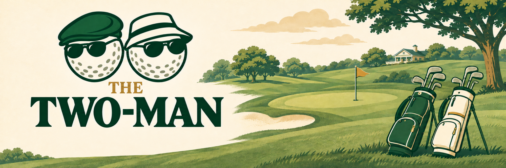

  

# The Two Man

The source code behind [thetwoman.site](https://www.thetwoman.site), the website for The Two Man golf tournament.

Players and friends use the site to follow match results, standings and the playoff bracket. The commissioner uses it to manage the tournament and publish results. This repository is public so you can see how the website works, including how scores become standings and playoff seeds.

## How it works

1. **Record a match.** Private match links support course setup and score entry. The commissioner can review and publish pod-play cards or post a playoff winner and result.
2. **Calculate the result.** The scoring code applies handicap strokes, compares each team's better net score on a hole, and calculates hole outcomes and match points.
3. **Publish and follow the season.** Finalized cards have official result snapshots. Public pages use match results to show the feed, standings, qualification and bracket. Commissioner tools support corrections and tournament administration.

The website is built with Next.js, React and TypeScript. Server-side code reads and writes PostgreSQL through Prisma; Vercel hosts the app. The [architecture guide](ARCHITECTURE.md) describes the routes, data model and boundaries in more detail.

## Read the code

| Question | Start here |
| --- | --- |
| How are matches scored? | [Scoring engine](src/lib/scoring/) and [tournament rules](docs/tournament-rules.md) |
| How do standings and qualification work? | [Standings](src/lib/server/standings.ts) and [qualification](src/lib/server/qualification.ts) |
| What is an official result? | [Result snapshots](src/lib/server/official-result-snapshot.ts) |
| How does the bracket advance? | [Bracket synchronization](src/lib/server/bracket-sync.ts) |
| What can the commissioner do? | [Admin pages and actions](app/admin/) |
| How are public pages assembled? | [Tournament pages](app/tournament/) and [public tournament data](src/lib/server/public-tournament.ts) |
| What behavior is checked? | [Regression tests](tests/) |

## Current development

`main` contains the existing database-backed website. Season 2 work is being developed separately in [`preview/` on the Season 2 branch](https://github.com/jcb79107/the-two-man/tree/codex/season-2-unslop-complete/preview): a static, fictional-data preview with browser-local commissioner workflows. It is not connected to the production database.

The banner above uses the current Season 2 identity. Repository presentation uses it while the existing website assets remain with their respective app versions. [Asset provenance](docs/assets/README.md) records its source.

## Working on the website

See [Contributing](CONTRIBUTING.md) for the change workflow and [Development](docs/development.md) for local setup. Existing [deployment](docs/vercel-deployment.md), [observability](docs/observability-runbook.md) and [launch](LAUNCH-RUNBOOK.md) notes remain available for maintainers.

Public source access does not grant access to the production database, administrator tools or private match links. Do not post credentials, private links or personal information in issues or pull requests.

The source is available under the [MIT license](LICENSE).
