# Season 2 player simulation audit

Audited November 9–10, 2026 against `ed27fa5` (PR #26). This is a new
experience audit after the technical platform audit. **Findings below are open;
this pass changes documentation only. No merge or deployment.**

## Verdict

The regular-season scorebook works well. The product loses the player's story
when the season advances: the bracket knows about playoff results, but the home
feed, match search and team page largely remain regular-season-only. The team's
award total also disagrees with the purse. Fix shared season state and result
coverage before doing more visual polish or launching Season 2.

## Method and simulation

I acted as Bennett & Reed (pod winner and eventual champion), then checked
Carter & Ellis (runner-up), Morgan & Wells (wild-card qualifier eliminated in the
quarters), and the teams outside the field. This was a local, fictional exercise,
not actual players using the product.

An isolated copy in `/tmp/two-man-player-simulation` used the PR's real components,
scoring functions and publication validator. Only its fixtures/publication changed.
The initial scouting pass used the shipped 15-of-18 sample. The simulation then
reset all 18 fixture statuses to unplayed and advanced through these states:

| State | Published regular matches | Published playoffs | What was inspected |
| --- | ---: | ---: | --- |
| Opening day | 0 | 0 | First visit, fixtures, rules, empty state, hypothetical drawn match |
| First result | 1 | 0 | 14–4 win, gross card, back nine, stroke allocation, pod/team page |
| Regular season complete | 18 | 0 | Six pod winners, two wild cards, seeds, quarterfinal pairings |
| Quarterfinals complete | 18 | 4 | Result page, next round, team page, eliminated team |
| Semifinals complete | 18 | 6 | Correct finalists, unplayed final status, elimination path |
| Season complete | 18 | 7 | 19-hole final, home, team, purse, careers, search, desktop bracket |
| Alternative tied finish | 18 | 0 | All seed/cut-line tiebreakers tied, with eight explicit confirmed seeds |

All seven staged publications passed `loadPublication`. All 25 main-path outcomes
were generated; representative player pages were exercised through the UI rather
than manually entering all 72 scores for each of 18 matches. Commissioner
publication was the simulated handoff, not an invented player submission flow.
The seed order was t1, t4, t7, t10, t13, t16, t2, t5. Bennett & Reed beat Carter &
Ellis in 19 holes. Main-path regular-season scores vary by pod to resolve seeding;
the alternative fixture intentionally ties every seed/cut-line tiebreaker.

The sample purse remains the existing proposed $4,500: $250 per pod winner,
$2,000 champion and $1,000 runner-up. These are **not approved Season 2 amounts**
and do not replace Season 1's confirmed $3,600 pool.

Capture: Chrome through computer-use tools (in-app Browser was unavailable),
primarily 390×844 with desktop bracket/tie checks at 1440px/default desktop size.
26 screenshots were captured in this run, saved, loaded and inspected. Loading
and unsettled-transition captures were replaced. Full-page capture can place the
fixed bottom navigation or skip link partway through the image; that artifact is
not reported as a product overlap defect.

## Player journey

| Step | Player task | Health | Evidence |
| --- | --- | --- | --- |
| 1 | Arrive and find my matches | Usable, slow discovery | 01, 04, 24 |
| 2 | Prepare, agree strokes, know what to send | Needs clearer handoff | 02, 03 |
| 3 | Try an opening-day playoff scenario | Broken result display | 05, 06 |
| 4 | Read the published score and verify strokes | Good core scorecard | 07, 08 |
| 5 | Check my pod and team | Good regular-season view | 09, 10 |
| 6 | Understand qualification and the cut line | Incomplete explanation; confirmed-tie conflict | 11, 25, 26 |
| 7 | Find my playoff opponent | Works, mobile follow friction | 12, 13 |
| 8 | Win/lose a quarterfinal and find what comes next | Bracket advances; team page does not | 14, 15, 17 |
| 9 | Reach and play the championship | Correct pairings/results; status/UI inconsistency | 16, 18, 23 |
| 10 | Check final recognition, earnings and history | Incorrect team award; stale discovery surfaces | 19–22, 24 |

## Reproducible defects

### B1 — High: team earnings omit championship and runner-up awards

**Evidence:** 20 and 21. After the final, `/teams/t1` still reports $250 earned;
`/earnings` correctly assigns that team an additional $2,000. The runner-up team
page also reports $250 instead of $1,250. Its career page correctly reports
$1,250 (22), making the inconsistency especially visible.

**Cause:** `TeamDetail` in `src/app.tsx` calculates only `podWinner ? podAward : 0`.
**Recommendation:** reuse the season award calculation already used for history;
show the combined award and its components wherever earnings appear.
**Acceptance:** champion $2,250; runner-up $1,250; other pod winners $250;
non-award teams $0 in this fixture. All views agree. Never label earned as paid.

### B2 — High: playoff results disappear from the primary player surfaces

**Evidence:** 15, 19, 20, 24. After the July 24 championship, Home still leads with
June 18 regular-season results. “All results” and Bennett search show only two
regular matches; the team page's “The matches” omits its three playoff games.
There is no championship acknowledgement on the current-season home/team page.
The correct playoff results exist in the bracket and career view.

**Cause:** Home, Matches and TeamDetail in `src/app.tsx` only read regular matches
from the store, while playoffs live in `publication.games`.
**Recommendation:** one derived current-season result collection for discovery;
keep regular-season statistics separate and clearly labeled. Include playoff
final scores, never playoff scorecards. Make the homepage reflect the season phase.
**Acceptance:** the final leads recent results; team search finds five games;
team page shows the title/finish and playoff path; pre-match shortcuts become
appropriate season-complete links. Regular record stays 2–0–0, not 5–0–0.

### B3 — High: confirmed seeds and qualification can contradict each other

**Evidence:** 25 and 26. The alternative publication explicitly confirms Sullivan
& Brooks and Morgan & Wells as seeds 7 and 8 after a complete tied season. The
bracket uses those teams correctly. Playoff picture instead projects Turner &
Reese and Mitchell & Stone into those slots, lists the confirmed qualifiers outside
the eight, and still says “Tiebreak needed.” The bracket also keeps its pre-confirmation
“Seeds are confirmed after regular-season play” notice.

**Cause:** Bracket reads `publication.seeds` for slots but `qualified(matches)` for
its notice; PlayoffPicture derives qualification without the confirmed seed list.
**Recommendation:** confirmed publication seeds take precedence consistently;
unresolved projections remain a separate state. Never break a real tie by ID order.
**Acceptance:** both views show identical confirmed participants/order and a
confirmed state. Without confirmed seeds, retain honest unresolved-tie feedback.

### B4 — Medium: opening-day scenario announces a result that is absent

**Evidence:** 05 and 06. With zero official matches, calculate the default 9–9
scenario. Comparison says “Scenario: Seed 1/Seed 7” and “See updated field,” but
the page still says the picture starts with the first completed match. The
`#projected-eight` target is absent; this was checked in the rendered DOM.

**Cause:** `src/playoff-picture.tsx` gates rendering on `current.field.length`
instead of the displayed scenario's `picture.field`.
**Acceptance:** a valid scenario renders the projected field and tie warnings,
its link reaches that field, and Reset restores the original empty state. No
scenario result becomes official or persists as a real result.

### B5 — Medium: known semifinal/final participants are labeled TBD

**Evidence:** 16. After both semifinals, the final displays Bennett & Reed and
Carter & Ellis but its header still says “TBD.”
**Cause:** `src/bracket.tsx` treats unplayed non-quarterfinal rounds as TBD even
when both participant IDs exist.
**Acceptance:** known pairing → Pre-match; unknown feeder → TBD; result → Final.

### B6 — Medium: active-season match return link loses the player's search

**Evidence:** 24 plus observed navigation. Search Bennett, open m1, choose “All
matches.” The URL becomes `/matches`, the search is empty, and all 18 regular
matches return. The archived-list return preservation does not cover this flow.
**Acceptance:** returning from a current match preserves query/status after reload;
returning from a bracket result preserves the selected team and round. Use fixed
local destinations, not an arbitrary return URL.

### B7 — Low: current demo career page carries the wrong provenance notice

**Evidence:** 22. Carter & Ellis's career page shows its simulated 2027 record,
five matches and $1,250 under a notice headed “Season 1 official archive,” saying
sample results are excluded from all-time records. The global record-book exclusion
may be correct, but this individual demo page's visible explanation is misleading.
**Acceptance:** show a contextual “Fictional Season 2 career” notice on these
profiles; keep real official all-time records isolated. No evidence of production
archive contamination was found.

## UX and UI improvements, ordered by player value

| ID | Recommendation | Evidence and reason | Acceptance |
| --- | --- | --- | --- |
| U1 | Put the player checklist on pre-match details | 02 repeats Pre-match three times; 03 contains the useful instructions elsewhere | Show approved deadline (or explicitly unconfirmed), coordinate in group text, GHIN setup, what to record and where to send it. Link directly to relevant rules. No scheduling form, account or upload feature. |
| U2 | Explain the decisive wildcard tiebreak | 11 shows qualifiers and excluded teams all at 1–1–0 and 18 points | Name the deciding statistic and show both values at the cut line; link to full standings. At season end, replace “bubble” with final qualification/finish language. |
| U3 | Bring the followed team into view on mobile | 13 selects Carter & Ellis while scrollLeft remains 0 and QF3 stays off-screen | Scroll the bracket container to the selected team's relevant match, preserve page position, respect reduced motion; keep full bracket as the default. |
| U4 | Make the existing team page easy to return to | 01/04 lead with the whole field; 10 is a useful destination discovered through standings | Surface Find your team prominently and consider an optional browser-local remembered team. Reuse the team page; do not introduce player accounts. |
| U5 | Give playoff results the same scorebook hierarchy | 14/18 render small score text, raw ISO dates and a generic View bracket link | Paired team rows, prominent match-play result, readable date/course, and next-round opponent/link. No extra playoff card or hole data. |
| U6 | Show combined team awards and the per-player split | 21 separates pod award and finishing award, with no personal total | After amounts/split policy are confirmed, show component awards, combined team total and equal share if applicable. Keep proposed/earned/paid distinctions explicit. |
| U7 | Tighten the regular-result summary and stroke panel | 07 says “12 holes won · 4 halved · 2 holes won”; 08 shows a blank “Holes” line for the zero-stroke player | Put team names beside counts, retain gross score symbols and separate net better-ball. Render “No strokes” instead of an empty holes list. |
| U8 | Improve opening-day and final-day information priority | 04 devotes the first screen to an empty results panel; 19 has an empty Still to play section after the final | Before results, promote fixtures/preparation; during playoffs promote active round; after final lead with champion and final. Derive this from existing results, not new editable phase flags. |

## What already works

- Traditional gross scorecard, separate net better-ball rows, explicit symbol
  legend and front/back-nine controls make the result auditable. The stroke panel
  exposes the recorded hole allocation without adding dots to gross cells.
- All 18 regular holes count in the simulated scoring; the 14–4 result agrees with
  12 holes won, four halved and two lost. The rules explain full-card reporting.
- Playoff feeder winners propagate correctly through all seven matches. Extra-hole
  final results work. Eliminated Morgan & Wells's followed path stops at QF1.
- Round-specific bracket views are useful on phones; the complete desktop tree
  is readable. Keep the full-tree option and existing brand.
- Purse total correctly reaches $4,500 in the completed fixture; the individual
  career view already derives the correct combined award and playoff record.
- Search has a visible focus style. Mobile More closes with Escape and restores
  focus to its button; the checked page has no document-level horizontal overflow.
- No player login, scheduling workflow, upload or payment is forced into the journey.

## Accessibility and evidence limits

Keyboard focus/Escape, semantic controls and the scorecard's accessible labels
were inspected. The missing scenario target is a confirmed navigation problem;
not bringing the followed match into view increases navigation effort. Dense
bracket links and utility copy deserve real-device touch and text-size testing.
No screen-reader, physical iOS/Safari, browser-zoom, formal contrast or WCAG
conformance assessment was performed. No claim of full accessibility compliance.

This is a simulated player walkthrough, not user research. Real GHIN setup,
group-text scheduling, evidence delivery, commissioner response time, payments,
external AI rules service, production permissions and network reliability were
not exercised. No real messages or payments were sent. All sample publication
changes stayed in the isolated copy. Season 1 and the real Season 2 source were
unchanged. No runtime fixes or new regression tests are claimed in this audit.

## Recommended implementation order

1. **Season consistency:** B1–B3 together, reusing existing history/award/bracket
   derivations so home, team, results, purse and qualification agree.
2. **Broken and misleading transitions:** B4–B7 plus follow-team visibility.
3. **Player handoffs:** pre-match checklist, tiebreak explanation, playoff result
   hierarchy and season-aware homepage. Retain the approved traditional scorecard.
4. Repeat these seven simulated states and both existing browser suites before
   merge/deploy. Add focused regressions for the missing states, rather than
   treating a mid-season-only smoke test as whole-season coverage.

Season 2 format, dates and amounts still require real confirmation before launch.
These findings do not turn the current fictional preview into an approved season.

## Screenshot evidence

Screenshots follow capture order; the journey table groups them into season order.

### 01. Midseason home

Clear recent scores; my next match and team context sit below the initial feed. Discovery improvement U4.

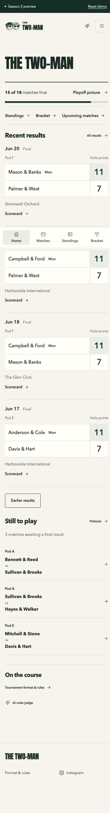

### 02. Pre-match

Opponent pairing is clear, but instructions stop at sending a full card. U1.

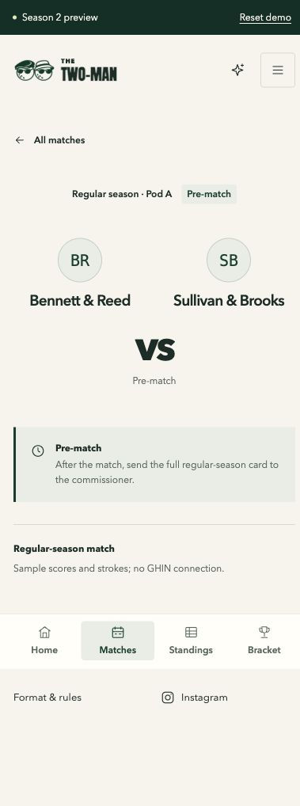

### 03. Rules

Useful GHIN and evidence instructions; dense paragraphs and no direct checklist from the match. Format remains explicitly TBD.

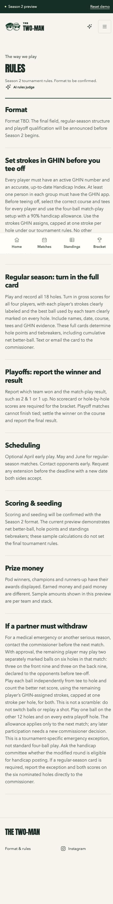

### 04. Opening day

Honest empty state, but it occupies the initial screen ahead of fixtures. U8.

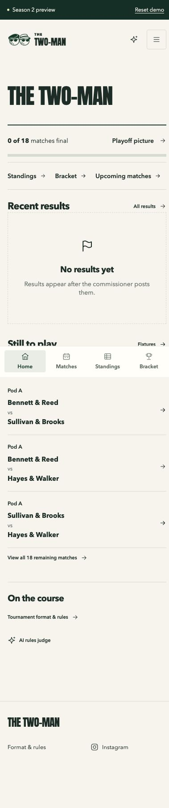

### 05. Opening qualification

No field before results is correct. Calculator is available.

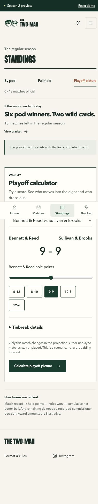

### 06. Opening scenario

Success comparison appears while field remains absent. B4. Full-page skip-link placement is a capture artifact.

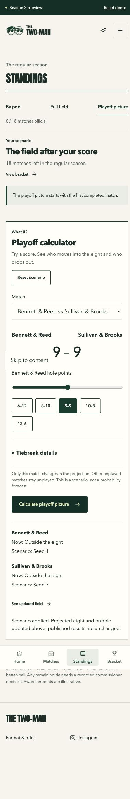

### 07. First result

14–4 agrees with hole outcomes; traditional scorecard remains clear. U7 summary clarity.

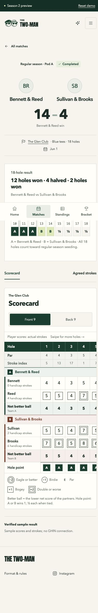

### 08. Recorded strokes

Exact receiving holes are available; zero-stroke player has an empty Holes label. U7.

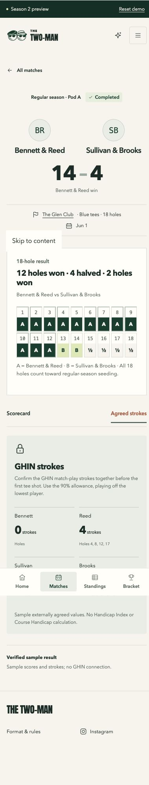

### 09. Pod standings

Readable record/points and tied ranks; long page requires finding the relevant pod. U4.

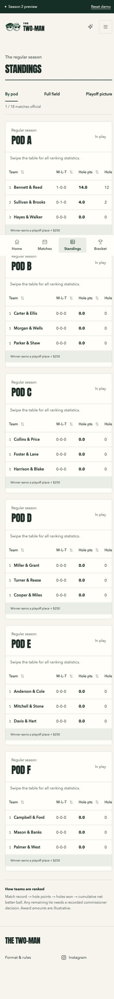

### 10. My team after one match

Useful regular record and two fixtures; a good existing destination to reuse.

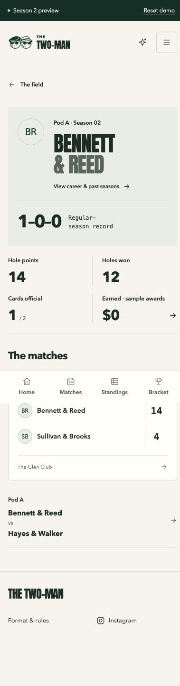

### 11. Qualified field

Correct untied seed order; visibly identical wild-card records omit deciding statistic. U2.

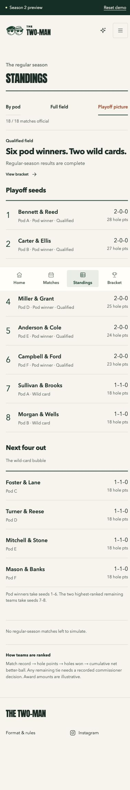

### 12. Quarterfinal pairings

Correct pairings and feeder paths; horizontally scrolling full tree on mobile.

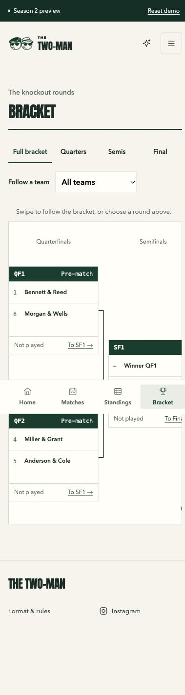

### 13. Follow away-side team

Selected Carter & Ellis remains off-screen at scrollLeft 0. U3.

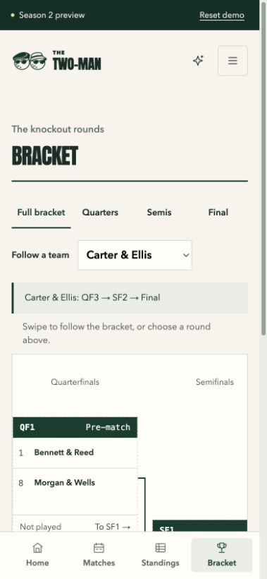

### 14. Quarterfinal result

Correct winner/margin; sparse layout and generic advancement link. U5.

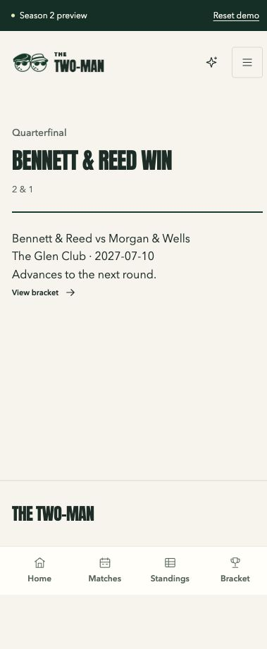

### 15. Team after quarterfinal

Team page still shows only regular matches. B2.

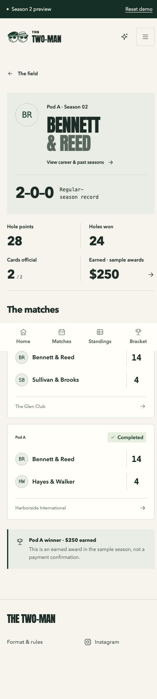

### 16. Final pairing

Correct two finalists under an incorrect TBD label. B5.

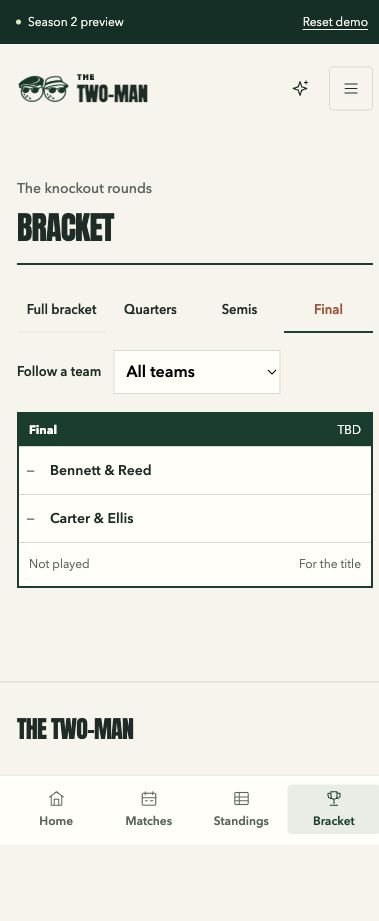

### 17. Eliminated team

Followed path stops at QF1; no false future advancement for Morgan & Wells.

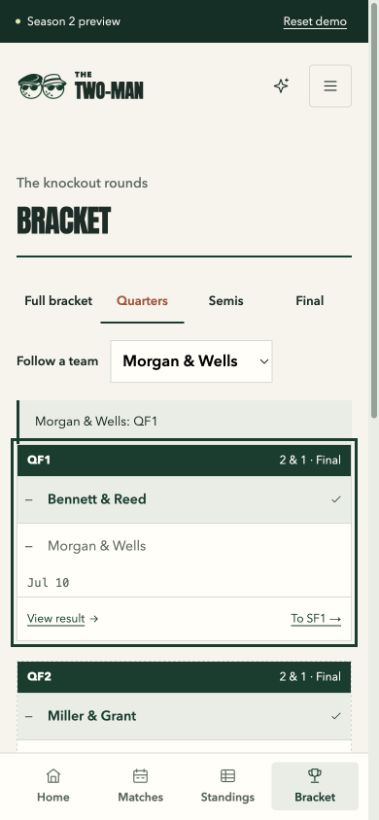

### 18. Championship result

19-hole final and champion label are correct; score hierarchy could match the rest of the site. U5.

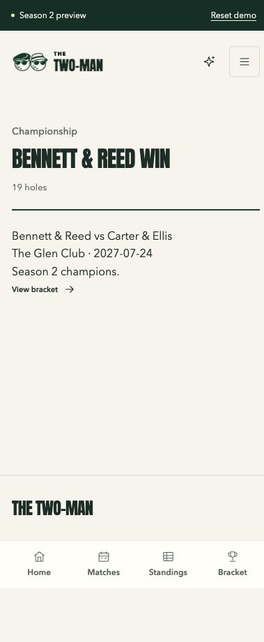

### 19. Home after championship

Recent results still lead with June regular games rather than July final. B2.

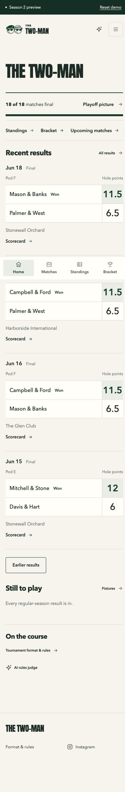

### 20. Champion team page

Only $250 and two regular games after title. B1/B2.

### 21. Completed purse

Correct $4,500 overall and champion/runner-up components; personal totals require arithmetic. B1 comparison, U6.

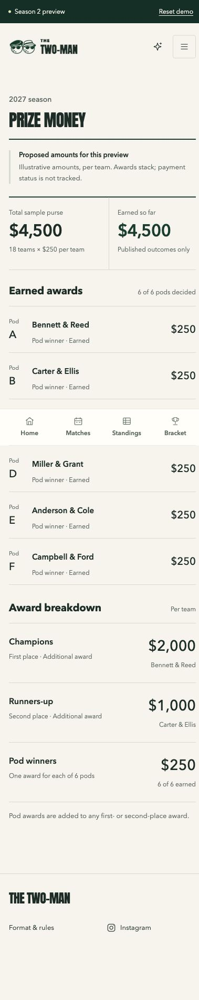

### 22. Runner-up career

Correct $1,250 and five games under a misleading Season 1 archive notice. B7.

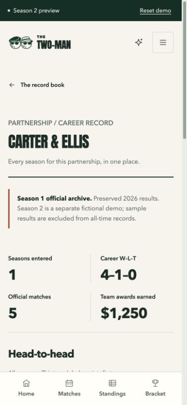

### 23. Completed desktop bracket

All seven outcomes and correct winner progression; useful wide layout.

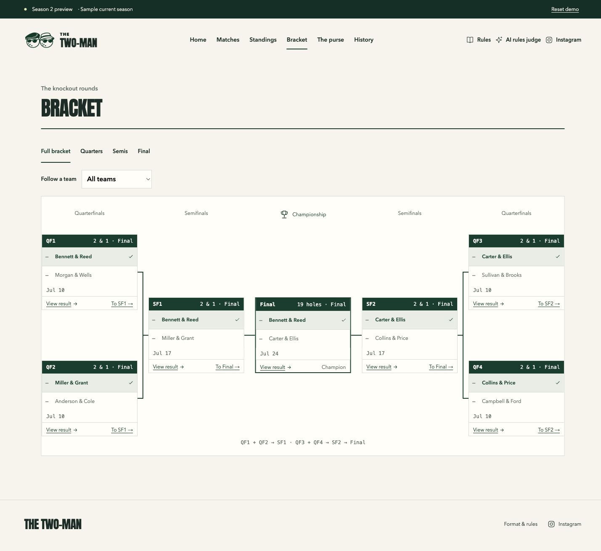

### 24. End-of-season search

Bennett search returns only two regular games; three playoff games are absent. B2/B6.

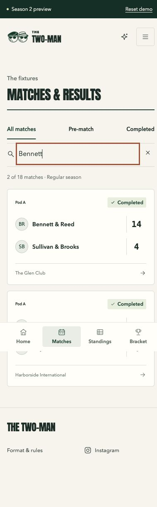

### 25. Tied standings, confirmed bracket

Explicitly confirmed seeds render correctly, but pre-confirmation notice remains. B3.

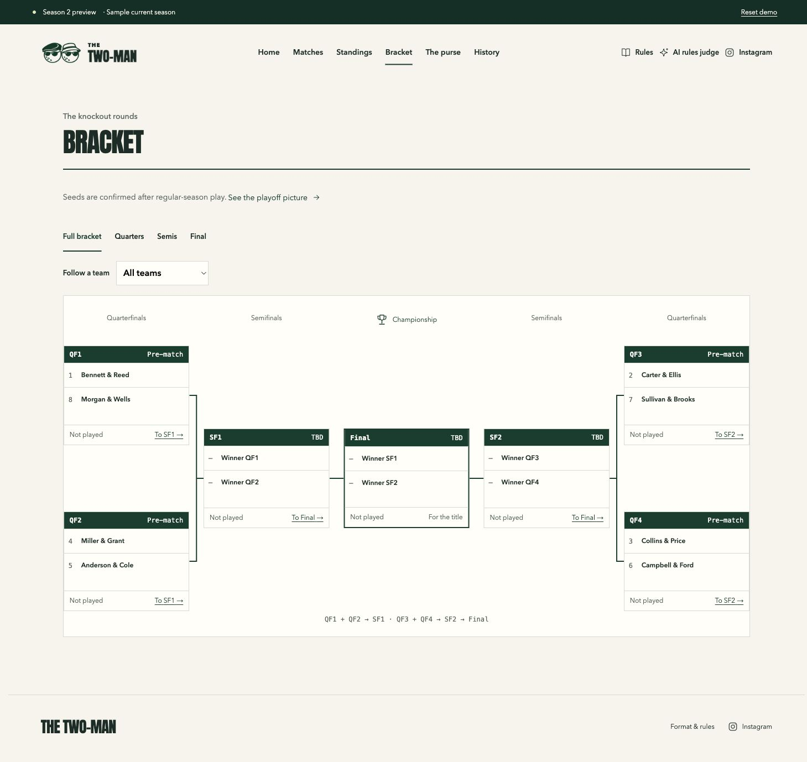

### 26. Conflicting qualification

Different wild cards appear despite confirmed publication seeds; unresolved-tie message persists. B3.

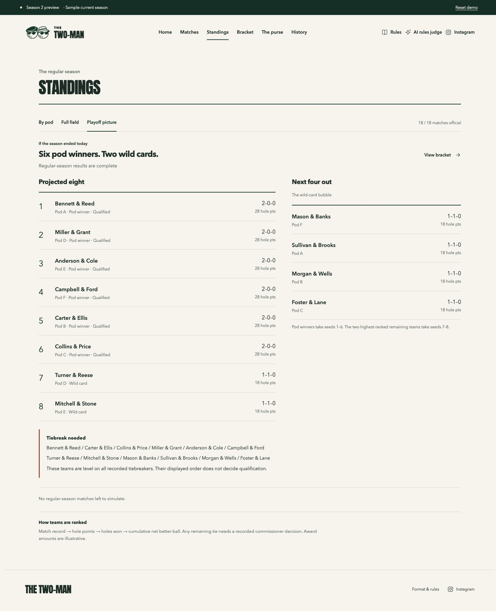
