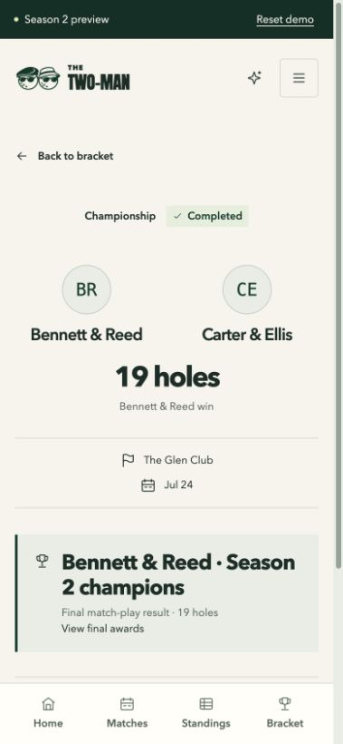
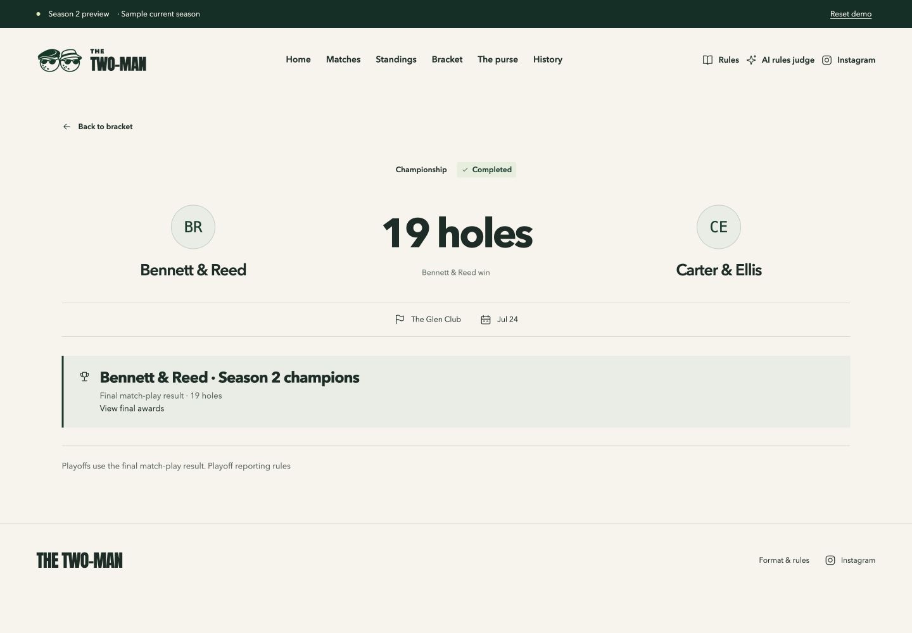
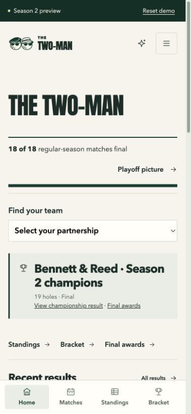
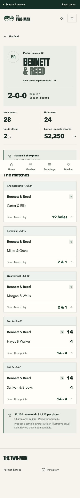
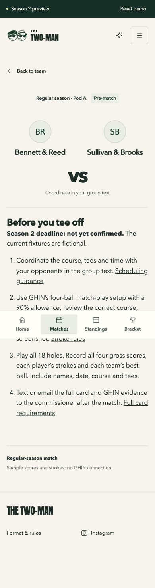

# Season 2 fixes and player rehearsal recheck

November 10, 2026. Follow-up to [the original audit](SEASON2-PLAYER-AUDIT.md).
All seven defects and eight requested UX improvements are addressed in the
fictional preview. No merge or deployment. Season 2 format, dates, amounts and
split policy remain unconfirmed; these changes do not launch a real season.

## What changed and was rechecked

| Findings | Result |
| --- | --- |
| B1, U6 | Team, career and purse use shared season awards. Champion $2,250, runner-up $1,250, other pod winners $250, non-recipients $0. Components stack and sample equal shares are explicitly illustrative. Earned never means paid. |
| B2, U8 | Home, match search and team pages include playoff results. The final leads the feed; Bennett search and team history show five matches while the regular record stays 2–0–0. Opening day promotes fixtures/preparation, playoffs promote known pairings, and final day recognizes the champion. |
| B3, U2 | Qualification uses confirmed seeds in their recorded order, matching the bracket even with all tiebreakers tied. Without confirmation, ties remain unresolved. Cutoff explanation shows the deciding statistic and both values; final exclusions do not claim a live bubble. |
| B4 | The first hypothetical 9–9 result now renders its projected field and anchor. Reset restores the empty official picture without persisting a scenario. |
| B5 | Known semifinal/final pairings show Pre-match. Unknown feeder opponents remain TBD. |
| B6 | Regular and playoff detail links preserve search/status or team/round after reload. Destinations are fixed local routes, not user-provided return URLs. |
| B7 | Demo career pages have a fictional Season 2 notice; official all-time records remain separate. The second review found and fixed the same notice on Season 2 history, plus a playoff-inclusive count mislabeled as regular results. |
| U1 | Pre-match details give the unconfirmed deadline, group-text coordination, GHIN setup, full-card requirements and commissioner text/email handoff, with direct rules anchors. |
| U3 | Follow a team centers its relevant match inside the bracket scroll area. Page position is preserved; scrolling is instant, with no motion to suppress. Elimination still stops the path. |
| U4 | Find your team links to the existing partnership page. Visual inspection caught and corrected the initial cramped select; it reuses the existing 44px control style. No accounts or remembered-team storage added. |
| U5 | Playoff result pages show paired teams, a prominent margin, readable date/course and next opponent/round or final-awards link. No playoff scorecard added. |
| U7 | Hole-win counts name both teams, and a zero-stroke player says No strokes. Gross score symbols and separate net better-ball stay intact. |

## Repeatable full-season simulation

Run `npm run test:simulation --prefix preview`. The script copies the app to an
isolated temporary directory and resets only the copied fixture statuses. It
validates each fictional publication and exercises the real app in Chromium at
desktop and iPhone-sized viewports. It stops on a failure and retains evidence.
No override endpoint, production fixture switch or dependency was added.

Seven stages, two browser projects each: **14 passing journeys**.

| Stage | Regular / playoffs | Verification |
| --- | --- | --- |
| Start | 0 / 0 | Team discovery, preparation checklist, first scenario, anchor and reset |
| Opening | 1 / 0 | First win, traditional card/back nine, zero-stroke display |
| Regular complete | 18 / 0 | Exact confirmed eight, decisive 13-vs-12 hole-win cutoff, followed away-side team visible |
| Quarters complete | 18 / 4 | Known semifinal pairing, playoff team history, eliminated path, preserved result return |
| Semis complete | 18 / 6 | Known final pairing, correct regular-only history count, return after reload |
| Final | 18 / 7 | Five champion games, 25 total games, stacked awards, final-led home, filtered search, all seven result pages, demo career disclosure |
| Tied finish | 18 / 0 | Confirmed seed order overrides tied projection; bracket and qualification agree |

The main path produces all 18 regular and seven playoff outcomes, ending with
Bennett & Reed over Carter & Ellis in 19 holes. Scores are generated fixtures;
this does not claim manual entry of all 1,296 individual hole scores. Existing
commissioner browser tests separately exercise validation, attestation,
correction, publication, damaged storage and failed-save recovery.

The first rehearsal attempt exposed a test race: reload ran before client
navigation completed. The test now asserts that the result is visible before
reloading. No timeout increase or retry was used to mask it.

## Second audit and verification

Reviewed the complete implementation diff and the shared call sites for awards,
qualification, history, result navigation and bracket progression. Rechecked
regular statistics versus playoff statistics, confirmed versus projected seeds,
fixed return destinations, sample versus official provenance, and source-data
integrity. No unresolved defect from this audit remains in the tested flows.

- Unit: **79 passed**, including new full-season totals, confirmed ties, cutoff
  explanation and fixed-route regressions.
- Existing demo browser suite: **52 passed**, desktop/mobile.
- Public offseason browser suite: **32 passed**, desktop/mobile, including all
  official match/player routes, payouts, gross cards, filters and PNG exports.
- Seven-stage simulation: **14 passed**, with no page errors or document overflow
  on the checked home, matches, team, purse and qualification surfaces.
- Demo and public static builds, typecheck, lint, format and tracked-artifact
  security checks passed. No new dependency.
- Manual Chrome review at 390×844 and 1440×1000: opening/final home, team discovery,
  champion history, final result, pre-match checklist and direct rules link.
  A regular result was opened from Bennett search, reloaded and returned with
  both the search and Completed filter preserved.
- Season 1 SHA256 is unchanged:
  `b3954c209d4c604bee07c3a9fbdc15331674e0380f7887b3b4c169976dca9a87`.
  Source Season 2 publication remains revision 0 with empty result arrays.

## Visual evidence

Full-page Chrome captures can put the fixed bottom navigation partway through
an image; it remains fixed to the viewport during ordinary scrolling.

## Limits and release boundary

This is simulated player testing, not real player research. Physical iOS/Safari,
screen readers, formal accessibility conformance, live GHIN, messages, payments,
commissioner response times and field performance were not tested. No real
messages or payments were sent. Optional remembered-team storage was skipped.
The live site remains the official Season 1 offseason site; never deploy the
fictional demo build to production. Follow OFFSEASON-LAUNCH.md when a later merge
and deployment are authorized.
