# App state machines

Audited November 9, 2026. Scope: active `preview/src`, route shell, browser storage,
CSS-owned notice lifetime, and the publication CLI. The retired database app is
excluded. These are behavior groups, not a requirement to introduce a reducer for
every control. Inputs, selections and derived projections are state too, but do
not need a workflow engine.

## Decision

Use a pure, typed transition function for commissioner review; use a tagged result
for asynchronous graphics. Keep URL state in the URL, storage effects in the
provider, business validation in the domain, and simple toggles in their owners.
No new runtime dependency or persistence format is needed.

This gives users accurate progress/recovery feedback, developers compiler-checked
states and small regression tests, and agents named transitions plus the boundary
map below. The types describe UI behavior; they do not replace validation or grant
permission to publish.

## Inventory and ownership

Paths below are relative to `preview/`. “Keep” means the existing representation
fits the behavior, not that it has a formal proof of correctness.

| Machine | States and transitions | Owner / durable source | Decision and invariant |
| --- | --- | --- | --- |
| Site mode and route availability | Build selects offseason or fictional demo; route resolves content or 404 | `src/site-mode.ts`, `app/[[...path]]`, `src/app.tsx` | Keep build-time mode. Root build is live; demo build must never be promoted. No runtime role/auth switch. |
| Browser restoration | Initial fixture → loading → validated saved season or fallback; draft restoration succeeds/fails separately | `src/store.tsx`; revision-scoped season and draft keys | Keep `ready` gate. Preserve rejected entries while other drafts are edited. Unreadable storage stays untouched even after edits (visit-only until explicit reset); replacing/discarding a specific draft removes its rejected entry. Offseason skips browser restoration. |
| Draft persistence | Absent → edited/retained → persisted or visit-only; resume; discard | `src/store.tsx`, `src/commissioner.tsx` | Keep drafts separate from official matches. Storage warnings are not success. Local storage is not private or cross-device storage. |
| Review and attestation | Edit → validation error or review/unconfirmed → review/confirmed; back/edit clears attestation | `src/review-state.ts`, `src/commissioner.tsx` | Explicit union/reducer. Validation stays in `approvalError` and the review handler. Attestation cannot coexist with edit or done. |
| Publication and retry | Confirmed review → domain error, done/visit-only, or done/persisted; successful retry promotes visit-only to persisted | `src/review-state.ts`, `src/domain.ts`, `src/store.tsx` | Explicit completion state. Only persist success clears the draft. Retry saves the existing season; it does not append or republish a result. |
| Correction | Official result → independent draft → validated, explained, attested replacement | `startingDraft`, `publishDraft` | Keep fresh correction note and fixture pairing checks. Original official result survives draft edits. |
| Draft discard confirmation | Closed ↔ confirming → remove draft and return | `src/commissioner.tsx` | Keep boolean. Confirmation affects only the draft, never the official result. |
| Demo reset confirmation | Closed ↔ confirming → restore sample, clear local drafts, return home | `src/app.tsx`, `src/store.tsx` | Keep explicit confirmation and existing visit-only storage warning. This is not a database reset. |
| Archive graphic generation | Invalid selection, generating, ready, failed; retry → new generating attempt | `src/archive-graphics.tsx`, `src/graphic-state.ts`; URL result ID | Tagged ready/failed result keyed by selection and retry. A nonmatching result means loading. Cancellation suppresses stale async completions; invalid IDs never substitute another game. |
| Demo graphic generation | Invalid/empty selection, generating, ready, failed; template/result change or retry starts new attempt | `src/commissioner-graphics.tsx`, `src/graphic-state.ts`; URL graphic/result | Same tagged result contract. Key also includes published matches. Preview and download use the same PNG; draft/scenario results are excluded. |
| Commissioner workspace selection | Graphics, results list, match editor, missing match | `src/commissioner.tsx`; URL tab/match/result/graphic | Keep URL ownership and match-keyed editor. Selection changes remount the correct draft. Unlisted URL is not authentication. |
| Public match lifecycle | Nonofficial fixture → official replacement; UI collapses internal statuses to Pre-match/Completed | `src/data.ts`, `src/domain.ts`, `src/ui.tsx`, `src/workflows.tsx` | Keep legacy fixture statuses for snapshot compatibility. Only official results count; draft cards stay out of public views. |
| Qualification | Unplayed/partial → projected field → unresolved tie or qualified field | `src/domain.ts`, `src/standings-view.ts` | Keep derived from official matches. No separately stored qualification flag; unresolved ties cannot become official seeds by display order. |
| Playoff progression | Seed placeholder → known participants → winner; feeder winner supplies next slot; elimination ends team path | `src/bracket-model.ts`, `src/publication.ts` | Keep pure derived graph and validated publication. Historical feeders remain distinct from demo layout. No predicted winners. |
| Playoff calculator | Editing → validation error or applied projection; edit/reset clears projection | `src/playoff-picture.tsx`, `src/standings-view.ts` | Keep local inputs and nullable applied snapshot. Recompute against published matches; a now-official match invalidates the scenario. Never persist hypothetical results. |
| Match filtering/search | All, upcoming, official plus query; legacy review maps to upcoming; empty results | `Matches` in `src/app.tsx`; URL filter/q | Keep URL and browser navigation. Unknown filters currently produce empty results; no routing behavior change in this audit. |
| Standings view and sorting | Pods/field/qualification; column selection flips asc/desc | `src/app.tsx`, `src/standings-table.tsx`; URL view/sort/direction | Keep derived ordering and competition rank separate. No synchronized local copy. |
| History and record browsing | Season/view, team/player, regular/playoff/all, rank, year, search; unavailable entity | `src/history.tsx`, `src/history-data.ts`; path/query | Archive results derive player/team search and phase filters from URL q/phase with focus-preserving reset actions. Phase rankings require an official appearance. Client-only filters use native history updates integrated with Next search parameters: dropdowns push history; search replaces it. Each edit reads the current URL, and filtering requests no route data. Empty scopes recover to all matches. Official all-time records exclude fictional seasons. |
| Bracket browsing | Full/overview/round; highlighted team path; next-round anchor | `src/bracket.tsx`; URL round/team, archive view | Keep URL selection and semantic links. Team path stops at elimination; selection does not mutate progression. |
| Scorecard display | Card/record section; front/back nine; gross player scores and net team better ball | `src/workflows.tsx` | Keep independent local selections. Nine change resets the table's horizontal scroll; unknown archive cards remain unavailable. |
| Fast score entry and paste | Hole/player selection; incomplete/complete derived count; paste editing/error/applied | `src/score-entry.tsx`, `src/score-entry-model.ts` | Keep bounded controls, parser validation, keyboard focus and draft-only writes. An 18-score row replaces one player only. |
| Navigation disclosure | More closed/open; link or Escape closes; Escape restores focus | `src/app.tsx` | Keep native button and local boolean. This is a disclosure, not a modal. |
| Native disclosures | Collapsed/expanded source card, editor, agreed strokes, definitions and scenario fields | Native `details` in component owners | Keep browser-owned state. Calculator validation opens correction fields without preventing edits. |
| Feed expansion | First four → next four → exhausted | `Home` in `src/app.tsx` | Keep local limit; items derive from official results. |
| Notice lifetime | Empty → announced/visible → CSS-hidden; reduced motion remains visible | `src/store.tsx`, `src/app.tsx`, `app/globals.css` | Keep existing presentation. Critical publication failure also has a persistent completion warning and Retry saving. Repeating the exact notice string does not remount it. |
| Purse scenario | Current awards ↔ illustrative final scenario | `Earnings` in `src/app.tsx`; URL scenario | Keep derived amounts. Earned/pending never claims payment; archive unknowns stay unknown. |
| Agent publication | Candidate → validated diff → optional write → checked/committed/deployed artifact; revision conflict rejects | `scripts/publish-results.ts`, `src/publication.ts`, `docs/CODEX-RESULTS.md` | Keep existing revision check, hash guard, exclusive temporary file and atomic rename. Validation defaults to read-only. No browser or state-machine event authorizes a production write. |

## Review transition contract

```mermaid
stateDiagram-v2
    [*] --> Edit
    Edit --> Edit: change / retain / validation error
    Edit --> Review: validated review
    Review --> Review: confirm / unconfirm / domain error
    Review --> Edit: back (clears attestation)
    Review --> VisitOnly: confirmed publish; storage failed
    Review --> Persisted: confirmed publish; storage succeeded
    VisitOnly --> VisitOnly: retry failed
    VisitOnly --> Persisted: retry succeeded
```

`reviewTransition` is pure: no storage, navigation, validation bypass or scoring.
Ignored events leave state unchanged. The event handler must run domain validation
before publication side effects; reducer guards alone cannot secure a write.

## Verification map

- `tests/review-state.test.ts`: forbidden publication, fresh attestation, feedback
  reset, and visit-only-to-persisted transitions.
- `tests/browser/journeys.spec.ts`: actual edit/review/back/publish, draft reload,
  failed-save recovery without duplicates, scorecards, scenarios and URL history.
- `tests/graphic-recovery.ts` used by both browser suites: deterministic decode
  failure, paused retry, loading feedback, no stale download/error, then success with focus on the download link.
- `tests/offseason/site.spec.ts`: official routes, graphics, missing results,
  metadata, navigation and 404 boundaries on desktop/mobile.
- Existing domain, publication, bracket, standings, archive and scoring tests retain
  their invariants, including the pinned Season 1 hash.

The audit does not add cross-tab concurrency, cross-device storage, authenticated
publication or a durable background service. Those require a separate product and
storage design. Browser-only completion and its recovery limits remain explicit.

See [the platform audit](PLATFORM-AUDIT.md) for the subsequent two-pass audit,
recovery regressions, historical ordering and tied-rank checks.
